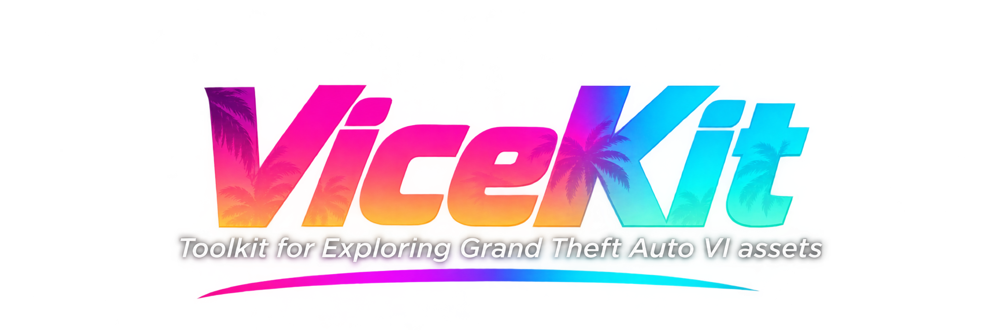

  

## About

ViceKit is a toolkit for exploring, inspecting and extracting assets from Grand Theft Auto VI.

The project aims to provide an all-in-one environment for exploring game archives, analyzing resource formats and visualizing game assets.

ViceKit is under active development, with new features and file format support being added progressively.

## Features

### Currently available

- RPF archive exploration
- Nested RPF archive navigation
- File extraction
- Hexadecimal viewer
- Text viewer

### Planned

- Texture viewer
- Interactive 3D model viewer
- Resource and metadata inspection
- Material and shader inspection
- Asset exporting
- Additional file format support
- More game asset exploration and analysis tools

## Platform support

ViceKit currently supports game files from Xbox Series X|S.

| Game platform | Status |
|---|---|
| Xbox Series X/S | ✅ Supported |
| PlayStation 5 | ⏳ Planned |
| PC | ⏳ Planned |

PlayStation 5 and PC support will be introduced when possible.

## Downloads

The latest version of ViceKit is available on the [Releases](../../releases) page.

ViceKit runs on Windows and is distributed as a portable application with its required runtime dependencies included. No installation is required.

## Getting started

1. Download the latest release from the [Releases](../../releases) page.
2. Extract the entire ZIP archive into a directory of your choice.
3. Launch `ViceKit.exe`.
4. Select the root directory containing your Grand Theft Auto VI game files.
5. Start exploring the game archives.

**Important:** The selected game directory must contain both the game executable and the game asset files, including the RPF archives. Selecting a directory containing only the asset files is not sufficient.

Do not move `ViceKit.exe` outside its extracted directory, as the bundled libraries and resources are required for the application to run.

Game files are not included with ViceKit and must be provided by the user.

## Feedback

Bug reports, feature requests and suggestions are welcome through the [Issues](../../issues) section.

## License

ViceKit is proprietary, closed-source software.

## Disclaimer

ViceKit is an independent, unofficial project and is not affiliated with, endorsed by, or associated with Rockstar Games or Take-Two Interactive.

ViceKit does not distribute original game files or assets.