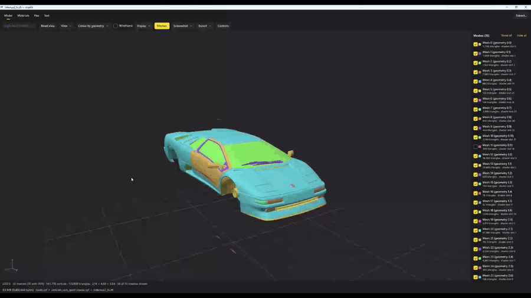
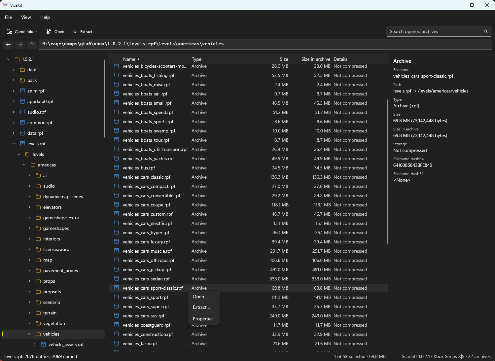
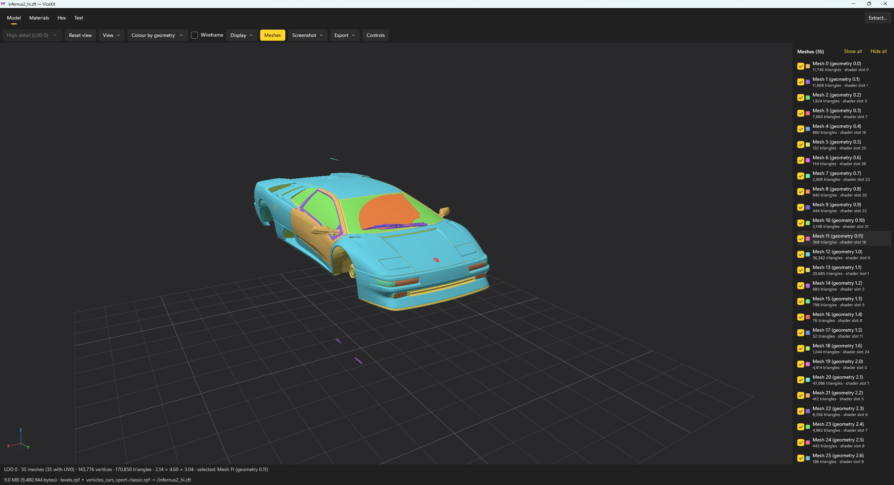
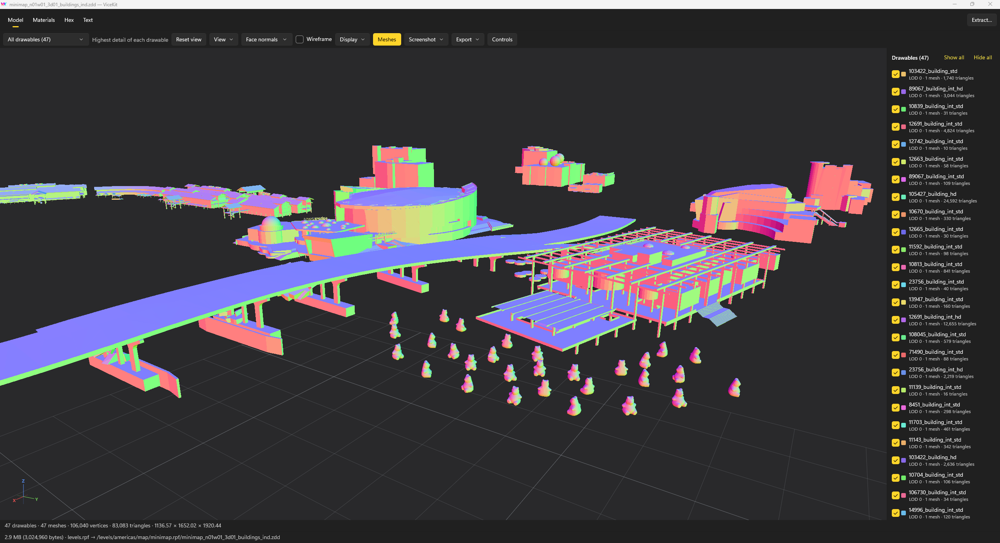
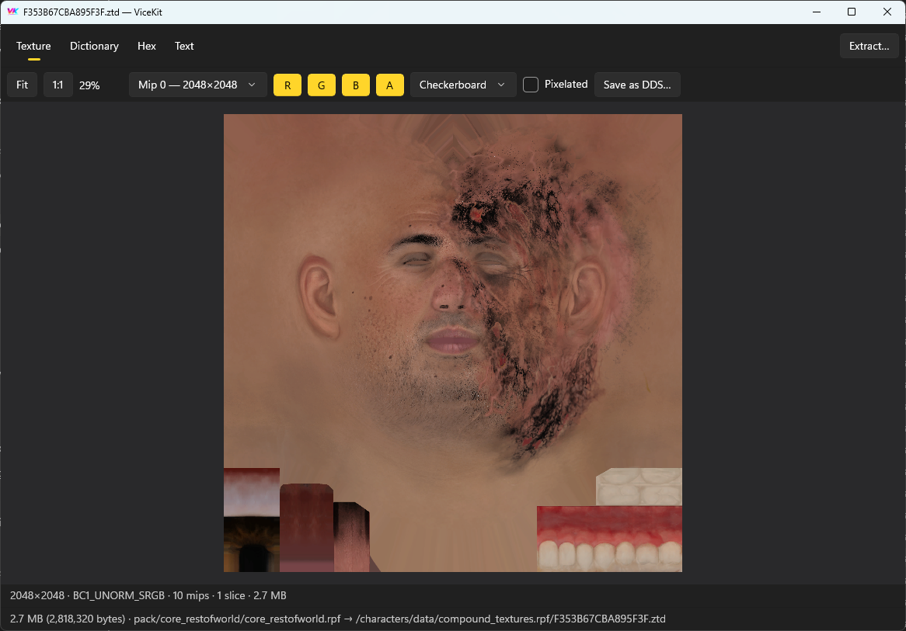
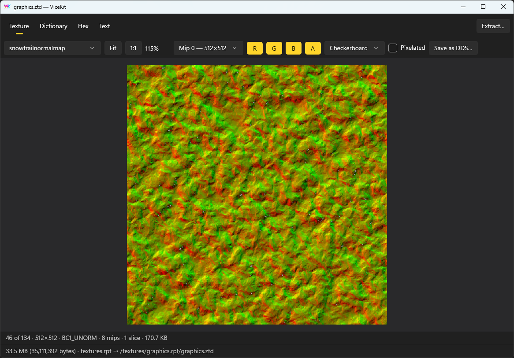

  

## About

ViceKit is a toolkit for exploring, inspecting and extracting assets from Grand Theft Auto VI.

The project aims to provide an all-in-one environment for exploring game archives, analyzing resource formats and visualizing game assets.

ViceKit is under active development, with new features and file format support being added progressively.

## Features

### Currently available

- RPF archive exploration, including nested archives, with over 575,000 known file names
- Search across the opened archives
- File extraction
- Hexadecimal and text viewers
- Metadata (`.zmt`) structure viewer
- Texture viewer for texture dictionaries (`.ztd`), with DDS export
- Interactive 3D model viewer for models (`.zdr`), fragments (`.zft`) and model dictionaries (`.zdd`)
- Material inspection: the shaders each mesh uses and the textures they reference
- Model export to glTF (`.glb`) and OBJ, and PNG screenshots

### Planned

- Textures applied on 3D models
- Streamed textures (`ttdb` packages)
- Assembled characters
- Search across all archives without opening them first
- Additional file format support
- More game asset exploration and analysis tools

## Screenshots

  

**Browse the game archives**, including the archives nested inside them.

  

**Inspect 3D models** mesh by mesh, or a whole model dictionary at once, with several display modes.

  
  

**View textures** with their mip levels and colour channels, and save them as DDS.

  
  

## Platform support

ViceKit currently supports game files from Xbox Series X|S.

| Game platform | Status |
|---|---|
| Xbox Series X/S | ✅ Supported |
| PlayStation 5 | ⏳ Planned |
| PC | ⏳ Planned |

PlayStation 5 and PC support will be introduced when possible.

## Downloads

The latest version of ViceKit is available on the [Releases](../../releases) page.

ViceKit runs on Windows and is distributed as a portable application with its required runtime dependencies included. No installation is required.

## Getting started

1. Download the latest release from the [Releases](../../releases) page.
2. Extract the entire ZIP archive into a directory of your choice.
3. Launch `ViceKit.exe`.
4. Select the root directory containing your Grand Theft Auto VI game files.
5. Start exploring the game archives.

**Important:** The selected game directory must contain both the game executable and the game asset files, including the RPF archives. Selecting a directory containing only the asset files is not sufficient.

Do not move `ViceKit.exe` outside its extracted directory, as the bundled libraries and resources are required for the application to run.

Game files are not included with ViceKit and must be provided by the user.

## Feedback

Bug reports, feature requests and suggestions are welcome through the [Issues](../../issues) section.

## License

ViceKit is proprietary, closed-source software.

## Disclaimer

ViceKit is an independent, unofficial project and is not affiliated with, endorsed by, or associated with Rockstar Games or Take-Two Interactive.

ViceKit does not distribute original game files or assets.